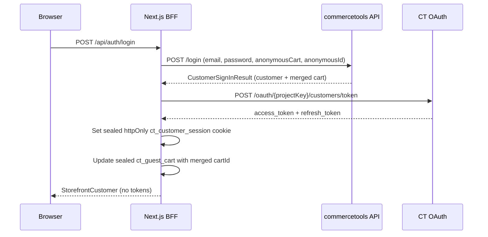

# Customer authentication

Customer sign-in, registration, password reset, and account management for **zero-to-ct-storefront**. All commercetools credentials and customer tokens stay on the server; the browser talks only to BFF routes under `/api/auth/*`.

## Architecture



## Session cookies

Every `ct_*` cookie is sealed: the value is encrypted and authenticated with AES-256-GCM, with a key derived from `SESSION_SECRET`, and is bound to its own cookie name, so a value copied from one cookie into another is rejected. All of them are `httpOnly`, `sameSite=lax`, `path=/`, and `secure` in production. A cookie that is missing, plain JSON from an older version, tampered with or sealed under another secret reads as "no session" (the user is signed out, the guest cart restarts). If `SESSION_SECRET` is unset or shorter than 32 random bytes, writing a session fails with an error that names the variable, and so does reading a cookie that is present (an absent cookie reads as "no session" before the key is derived). Generate one with `openssl rand -base64 32`; rotating it signs everyone out.

| Cookie | Lifetime | Purpose |
|--------|----------|---------|
| `ct_customer_session` | 30 days | Customer access token, refresh token, `expiresAt` and `customerId`. The only source of `customerId` for the BFF. |
| `ct_guest_cart` | 30 days | Guest cart `anonymousId` + `cartId` (updated after login/register) |
| `ct_wishlist` | 30 days | Wishlist `anonymousId` + `shoppingListId` (updated after login/register) |
| `ct_storefront_market` | 365 days | Selected market country |
| `ct_market_carts` | 30 days | Cart id per market country, so switching markets restores the cart parked there |
| `ct_last_order` | 1 day | `orderNumber` + `cartId` of the order just placed; `/order-confirmation` trusts only this cookie plus the order lookup, not a URL parameter |

Tokens never reach the client JavaScript bundle. Customer tokens request only the scopes in `CTP_CUSTOMER_SCOPES` (see below), so a leaked token cannot act with the full API client scopes.

## BFF routes

| Route | Method | Description |
|-------|--------|-------------|
| `/api/auth/login` | POST | Sign in; merges guest cart when present |
| `/api/auth/register` | POST | Create account; merges guest cart when present |
| `/api/auth/logout` | POST | Revoke the refresh and access tokens (best effort), then clear the customer, cart, wishlist, market-cart and last-order cookies |
| `/api/auth/session` | GET | Safe customer profile DTO or `null` |
| `/api/auth/forgot-password` | POST | Request password reset token |
| `/api/auth/reset-password` | POST | Set new password from token |
| `/api/customer/orders` | GET | Authenticated order history (`limit`, `offset`) |
| `/api/customer/profile` | PATCH | Update first name, last name, email (`POST /me`) |
| `/api/customer/addresses` | POST | Add customer address |
| `/api/customer/addresses/[addressId]` | PATCH, DELETE | Update or remove address |
| `/api/customer/password` | POST | Change password (`POST /me/password`); clears session |

Order detail is loaded server-side on `/account/orders/[id]` via `GET /me/orders/{id}` (no separate BFF route).

## Required API client scopes

Add these to the **Frontend application** API client in Merchant Center (in addition to existing cart/checkout scopes):

```
manage_customers:{projectKey}
manage_my_profile:{projectKey}
manage_my_orders:{projectKey}
manage_shopping_lists:{projectKey}
```

Update `CTP_SCOPES` in `.env.local` accordingly. `create_anonymous_token` is not used by this storefront and is not required.

Customer sessions request only the scopes in `CTP_CUSTOMER_SCOPES` (space-separated; `{pk}` is replaced by `CTP_PROJECT_KEY`). The default is `manage_my_profile:{pk} manage_my_orders:{pk}`. Every entry must exist on the API client, otherwise the password grant fails with `invalid_scope` and the BFF logs a configuration hint. The Checkout session token is limited to `manage_sessions:{pk}`.

| Operation | CT endpoint | Scope |
|-----------|-------------|-------|
| Register / login / password reset | Platform API (`/customers`, `/login`) | `manage_customers` |
| Customer session token | OAuth `/customers/token` | `CTP_CUSTOMER_SCOPES` (must exist on the client) |
| Profile | `GET /me`, `POST /me` | Customer token (`manage_my_profile`) |
| Change password | `POST /me/password` | Customer token (`manage_my_profile`) |
| Order history | `GET /me/orders` | Customer token (`manage_my_orders`) |
| Order detail | `GET /me/orders/{id}` | Customer token (`manage_my_orders`) |

## Cart merge

Merging is done by commercetools, not by the storefront. On login and register the BFF sends the guest cart from `ct_guest_cart` as `anonymousCart` together with its `anonymousId`, and only when the cart is an active guest cart whose `anonymousId` equals the one in the cookie (`getOwnedGuestCartRef` in `lib/commercetools/cart.ts`). A cookie that points at a customer-owned or foreign cart is not sent, so sign-in still succeeds without a merge. Login uses `anonymousCartSignInMode: MergeWithExistingCustomerCart`. The storefront does not merge line items or SKUs itself. After success, `ct_guest_cart` holds the merged cart id and a **fresh** `anonymousId` (commercetools consumes the previous one; if it was already consumed, the request is retried once without the guest cart).

When a customer is already signed in, cart operations in `lib/commercetools/cart.ts` resolve the active cart against the `customerId` from the sealed session. The BFF finds or creates a customer cart (queried with input-variable predicates on `customerId`, `country` and currency), or assigns the browser's guest cart to the customer with `setCustomerId` when the cart's `anonymousId` matches the session's. This runs before checkout (`getCartForCheckout`), cart mutations and cart display. Orders created from Checkout inherit `customerId` and appear in `/account` order history.

When sign-in returns no merged cart, `reconcileCartOnAuth()` restores the customer's existing cart into `ct_guest_cart`.

**Logout:** `ct_guest_cart`, `ct_market_carts` and `ct_wishlist` are cleared. The customer cart and wishlist remain on the commercetools account and are restored on the next login.

## Token refresh and logout

Customer access tokens are short-lived. The root proxy (`proxy.ts`, `lib/http/proxy/customer-session-refresh.ts`) refreshes a token that expires within 60 seconds using the refresh token, before the page or route runs. The new sealed cookie is set on the response and on the forwarded request, so the same request already sees the new token. If commercetools rejects the refresh token (400/401), the cookie is deleted and the user is treated as signed out; on 5xx or network errors the cookie is left alone and the next request tries again.

Server Components cannot write cookies, so render paths are read-only: `getCustomerAccessTokenForRender()` returns the token while it is still valid and never refreshes or writes. Route Handlers and Server Actions use `getValidCustomerAccessToken()`, which refreshes when near expiry.

The proxy also refuses cross-origin state-changing requests to `/api/*` with 403: `Sec-Fetch-Site` must be `same-origin`; for browsers that do not send it, the `Origin` header must match the request origin. Clients that send neither (curl, server-to-server) are not affected.

`POST /api/auth/logout` revokes the refresh token and the access token at `POST /oauth/token/revoke` and then clears the session cookies. Revocation is best effort: when the Authorization Server is unreachable, the cookies are still cleared and the failure is logged without token values.

## UI flows

- **Sign in / Register** — header dialog; stays on the current page after success (`router.refresh()`).
- **Forgot password** — dialog step; generic success message (no email enumeration).
- **Reset password** — `/reset-password?token=...` page.
- **Account** — `/account` (editable profile, address CRUD, change password, linked order history); `/account/orders/[id]` (order detail with line items, addresses, and totals). Unauthenticated users redirect to `/?login=1` to open the sign-in dialog.

### Email change

The BFF sends commercetools `changeEmail` and relies on it to enforce uniqueness atomically: a `DuplicateField` error maps to HTTP 409 ("An account with this email already exists"). There is no separate availability pre-check. Changing email resets `isEmailVerified` in commercetools (email verification remains out of scope without an ESP).

### Change password on account

`POST /api/customer/password` calls `POST /me/password` with the current customer token. On success, `ct_customer_session` and `ct_guest_cart` are cleared and the UI prompts for sign-in again (CT invalidates prior customer tokens).

## Development-only password reset

When `NODE_ENV !== 'production'`, `POST /api/auth/forgot-password` may include `devResetUrl` in the JSON response because this PoC does not send emails. Production returns only the generic message.

## Out of scope (PoC)

- Email delivery (ESP)
- Email verification after profile email change
- Store-scoped customers

## Related docs

- [CHECKOUT.md](./CHECKOUT.md) — guest cart and checkout
- [AGENT_CODING.md](./AGENT_CODING.md) — BFF conventions
